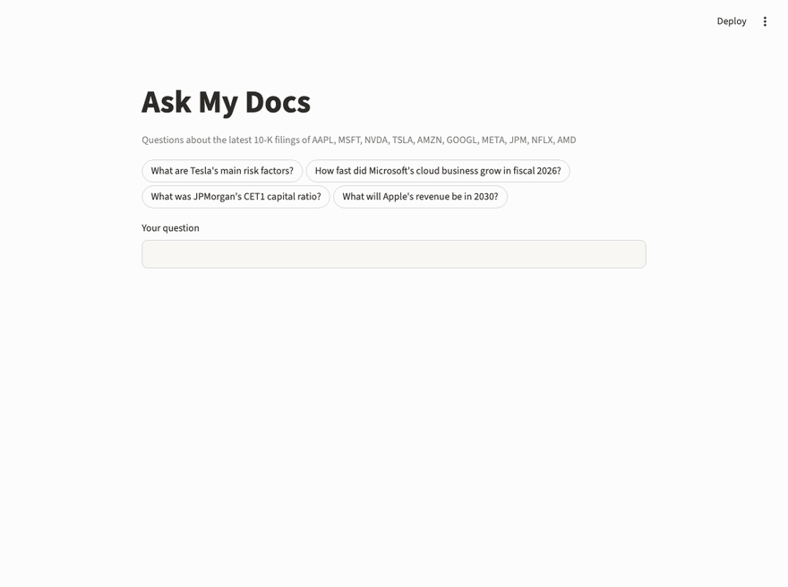

# Ask My Docs — production-grade RAG over SEC 10-K filings

> **Project 3 — Observability** extends this RAG system (forked from Project 1).
> Phase 1 done: every request is traced step by step in self-hosted Langfuse —
> retrieval, re-ranking, the exact LLM prompt, tokens, cost, time-to-first-token and
> guardrail decisions. Setup and how to read a trace: [docs/observability.md](docs/observability.md).
> `make langfuse-up`, then `make ask Q="..."` prints a link to the trace.
> Phase 2 done: p50/p95 latency, cost, citation coverage, refusal/error rate and sampled
> online faithfulness over time (`make metrics`, `make dashboard`), with calibrated alerts.
> Incident drill: [docs/incident-001.md](docs/incident-001.md) — a "cost optimization" that
> silently cut answer evidence, root-caused in under 7 minutes.
> Phase 3 done: every PR runs the golden-set eval, is compared with `main`, gets a comment
> table (metric, main, PR, Δ) and fails on regressions: [example](docs/example-pr-comment.md) —
> a prompt-only "readability" change that dropped citation coverage 96% → 71%.

Ask a question about 10 companies' latest 10-K annual reports and get an answer with
citations to the exact source passage, or a refusal when the filings don't contain the answer.
Every pull request is gated by an automated evaluation that **fails the build if answer quality drops**.

Companies: AAPL, MSFT, NVDA, TSLA, AMZN, GOOGL, META, JPM, NFLX, AMD (2,439 chunks).



*Ask a question → cited answer → open source [1] to see the passage it came from → an out-of-scope
question is refused. Recorded from the real UI; the yellow highlight on the cited line was added
for the recording.* Project site: [ask-my-docs-ivory.vercel.app](https://ask-my-docs-ivory.vercel.app)
(source in [`site/`](site/), deployed with Vercel).

## Quick start

```bash
make setup                         # install Python deps with uv
export ANTHROPIC_API_KEY=...       # answering model + eval judge
export SEC_USER_AGENT="Your Name your@email.com"   # SEC asks bots to identify themselves
make ingest                        # download -> parse -> chunk -> embed -> Chroma (~1-2 min)
make serve                         # API on http://localhost:8000  (docs: /docs)
make ui                            # UI on http://localhost:8501  (second terminal)
```

| Command | What it does |
|---|---|
| `make ask Q="..."` | answer in the terminal (`--debug` shows scores + per-sentence checks) |
| `make test` | 14 offline unit tests (parsing, chunking, RRF, guardrails, gate logic) |
| `make golden` | rebuild `eval/golden_set.jsonl` from `eval/golden_seed.yaml` |
| `make ablation` | vector vs BM25 vs hybrid vs hybrid+rerank → `eval/reports/` |
| `make eval` | full RAGAS evaluation, 63 questions (~$3.80 judge cost) |
| `make ci-local` | exactly what GitHub Actions runs: fixture index + gated eval (~$2) |

## Architecture

```
Ingestion:  SEC EDGAR ─► sec.py ─► parse.py (pages + Item sections) ─► chunking.py (500 tok, 100 overlap)
                     ─► index.py (bge-small embeddings → Chroma)   [BM25 is built from Chroma at startup]

Query:      question ─┬► BM25 top-20 ───┐
                      └► vector top-20 ─┴► RRF merge ─► cross-encoder re-rank (bge-reranker-base) ─► top 5
                                                                   │
                     best score < 0.05 → refuse (no LLM call) ◄────┤
                                                                   ▼
                     Claude Haiku 5.5 + versioned prompt (configs/prompts/answer_v2.yaml)
                                                                   ▼
                     guardrails.py: every sentence needs a retrieved citation whose text contains
                     its numbers and most of its words; unsupported sentences removed, too few left → refuse
                                                                   ▼
                     {answer, citations[], refused, prompt_version, latency_ms} → logs/answers.jsonl

CI (every PR):  fixture corpus (3 filings) ─► build index ─► eval/run_eval.py --gate
                ─► fail if faithfulness / hit rate@5 / refusal accuracy / citation coverage < thresholds
```

## Results

Golden set: **63 hand-verified questions** — 52 answerable (each with an exact evidence quote
from the filing) + 11 that must be refused (future years, companies not in the corpus,
off-topic, investment advice). Judge: Claude Opus 5.5 via RAGAS.

**Retrieval ablation** (52 answerable questions, no LLM involved):

| Setup | Hit rate@5 | MRR@5 | p50 retrieval latency |
|---|---|---|---|
| Vector only | 75% | 0.60 | 8 ms |
| BM25 only | 62% | 0.48 | 1 ms |
| Hybrid (BM25 + vector, RRF) | 81% | 0.64 | 11 ms |
| Hybrid + re-rank | **89%** | **0.71** | 756 ms |

**Full system** (hybrid + re-rank + citation enforcement, prompt `answer_v2`), all 63 questions:

| Hit rate@5 | Context recall | Faithfulness | Answer correctness | Citation coverage | Refusal accuracy | p50 / p95 latency |
|---|---|---|---|---|---|---|
| 89% | 93% | **98%** | 83% | 99% | 95% | 1.7 s / 2.8 s |

- All 11 must-refuse questions were refused. The 3 refusal errors are all *false* refusals of
  answerable questions whose source chunk retrieval missed; the model then correctly said it
  couldn't answer. Retrieval is now the bottleneck, not generation.
- Answer correctness counts a wrongly refused answerable question as 0.
- Reports: `eval/reports/eval_full_v2.md` (per-question), `eval/reports/ablation_*.md`.
- Faithfulness and correctness were only measured for the final setup. To fill the other rows:
  `uv run python eval/run_eval.py --mode vector --no-guardrails` (and `--mode hybrid`).

**CI gate demo** (3-company fixture subset, 39 questions):

| Prompt | Faithfulness | Hit rate@5 | Refusal accuracy | Citation coverage | Gate |
|---|---|---|---|---|---|
| `answer_v2` (normal) | 99% | 93% | 100% | 95% | ✅ pass |
| `answer_broken_demo` (no grounding/citation/refusal rules) | — | 93% | 28% | — | ❌ fail |

With the broken prompt the model answers without citations. The guardrails then refuse every
answer, so refusal accuracy collapses and the gate fails. Hit rate is unchanged, which shows the
metrics isolate *which* component regressed.

## How the CI gate works
`.github/workflows/eval.yml` runs on every pull request:
1. unit tests;
2. builds a fresh Chroma index from `data/fixtures/` (3 parsed filings, committed — no SEC download in CI);
3. runs `eval/run_eval.py --tickers AAPL TSLA NVDA --gate`, which exits with an error if any
   metric in `configs/config.yaml → eval.thresholds` is below its threshold;
4. posts the Markdown report to the job summary and uploads it as an artifact.

Setup: add `ANTHROPIC_API_KEY` as a repository secret. Without it the job fails on purpose,
because a skipped gate is no gate. Try it: open a PR that sets
`prompt.version: answer_broken_demo`, and CI goes red.

## What went wrong & how I fixed it
- **Section labels:** Microsoft repeats "Item 1" as a page header on every page, so "take the last
  'Item 1' line" picked a page header. Fix: prefer the first line that has a title and is not a
  table-of-contents row (TOC rows end in a page number or range like "9-31").
- **Golden label too narrow:** JPMorgan states its CET1 ratio in three places; the re-ranker found
  the other two and got marked wrong. Fix: `evidence` can list several quotes. Labels are derived
  from quotes, never typed by hand, so they survive re-chunking.
- **Short cited sentences ignored** by the guardrail ("Cupertino, California [id]"), making correct
  short answers refusable. Fix: anything with a citation counts as a claim. Caught by a unit test.
- **RAGAS `FactualCorrectness` scored 0 even for perfect answers** in this setup; switched answer
  correctness to RAGAS `AnswerAccuracy`, which behaved correctly on hand-checked examples.
- **Judge vs. model:** Opus 5.5 rejects forced tool calls, so RAGAS runs the judge in JSON mode.
  The judge is a stronger model than the answerer, so the system isn't grading its own output.

## Known limits
- Retrieval misses remain (~11%), mostly vocabulary mismatch ("self-driving" vs "fully autonomous").
- JPMorgan's 10-K attaches its annual report as an exhibit, so most JPM chunks are labelled Item 15;
  Netflix's financial statements follow Item 16 and are labelled that way.
- Page numbers are physical pages in the HTML, not printed page numbers.
- The guardrail's support check is lexical (words + numbers). Semantic faithfulness is measured
  offline by the RAGAS judge, not enforced at request time.
- The golden set was built by me (the developer) from the filings; a second reviewer would make it stronger.

## Resume bullets
- Built a production RAG system over SEC 10-K filings with hybrid BM25 + vector retrieval and
  cross-encoder re-ranking, improving retrieval hit rate@5 from **75% to 89%** and reaching
  **98% faithfulness** (RAGAS) on a 63-question hand-verified golden set.
- Added citation enforcement and refusal logic (refused **11/11** out-of-scope questions) and gated
  every pull request with an automated RAGAS evaluation in GitHub Actions that fails the build on
  regressions, demonstrated by a deliberately broken prompt failing CI.
