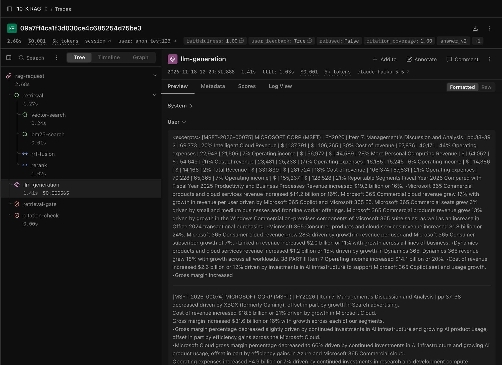
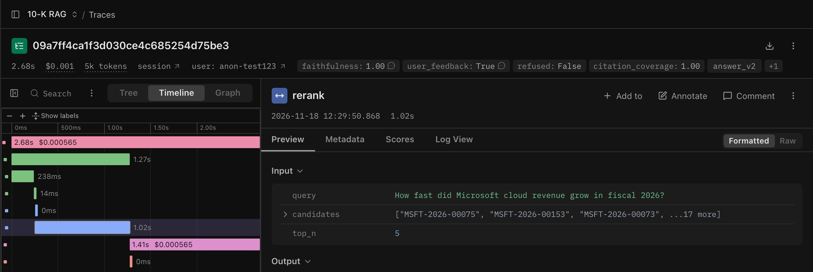
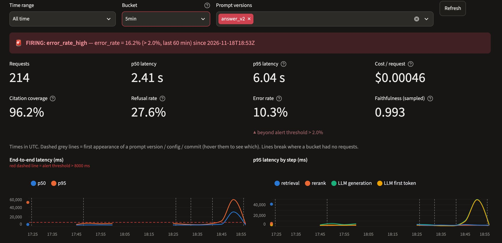
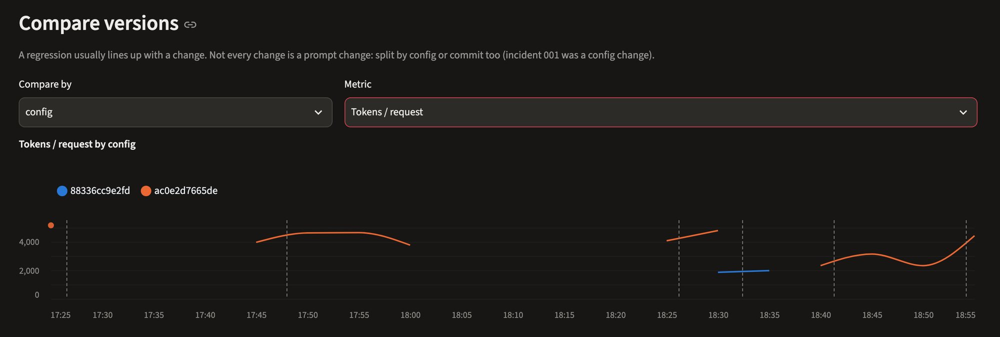

# RAG Observability — trace it, measure it, gate it

Monitoring and observability for a production RAG system (Q&A over ten companies' SEC
10-K filings, from [production-rag](https://github.com/krushaalkalkani/production-rag)):
every request traced step by step in self-hosted Langfuse, quality and cost tracked over
time with calibrated alerts, a real incident root-caused from the dashboard, and a CI gate
that fails a pull request when quality drops against `main`.

**Live overview:** https://rag-observability.vercel.app ·
**Incident write-up:** [docs/incident-001.md](docs/incident-001.md) ·
**Failing PR:** [#1](https://github.com/krushaalkalkani/rag-observability/pull/1)

> Building the system is ~30% of the work. The rest is knowing whether it works, why it
> fails, and fixing it fast. This project is that 70%.



## Headline results

| | |
|---|---|
| **Root cause in 6.7 min** | an injected config regression, found from the dashboard and confirmed from two traces ([incident 001](docs/incident-001.md)) |
| **9 steps per request** | traced: vector + keyword search, fusion, re-ranking (before → after), relevance gate, LLM call, citation check |
| **Prompt-only PR blocked** | citation coverage 95% → 66% vs `main`; CI failed and explained why ([PR #1](https://github.com/krushaalkalkani/rag-observability/pull/1)) |
| **Thresholds from data** | alert and CI tolerances set from measured noise, not guessed — e.g. p95 moved +29% between two identical runs |

## Phase 1 — Tracing every step

Every request is one trace in **self-hosted Langfuse** (Docker), and each pipeline stage is
a span with what a debugger needs:

```
rag-request              question → answer, latency, cost, scores
 ├─ retrieval            final top-5 chunks (ids, scores, preview)
 │   ├─ vector-search    top-20 by meaning
 │   ├─ bm25-search      top-20 by exact words (+ the tokens searched)
 │   ├─ rrf-fusion       merged order; which chunks both found
 │   └─ rerank           every candidate: old rank → new rank, score, kept?
 ├─ retrieval-gate       refuse before the LLM if nothing is relevant?
 ├─ llm-generation       exact prompt, output, tokens, $ cost, time-to-first-token
 └─ citation-check       which sentences were dropped and why, coverage
```

Every trace carries `prompt_version`, `config_hash` (fingerprint of the behaviour-relevant
config), `git_sha` and an anonymous session id; scores `refused`, `citation_coverage` and
`user_feedback` (👍/👎 in the UI) are attached to it.



Two details that mattered:
- **Cost is computed by us.** The Anthropic SDK's own trace span priced only visible output
  tokens and missed Haiku's billed *thinking* tokens (238 vs 816 output tokens on one
  request) and double-counted the call. Only our spans are exported.
- **Streaming** so time-to-first-token — the latency a user actually feels — is measured.

## Phase 2 — Quality metrics over time

`make metrics` pulls finished traces from Langfuse into SQLite, grades a stable 10% sample
for **faithfulness** with an LLM judge (no ground truth needed), rolls everything up per
time bucket, and checks alert rules. `make dashboard` shows it.



*The alert is real: a network outage on Nov 18 failed 22 of 30 requests and
`error_rate_high` fired on its first check.*

| Metric | Baseline (90 requests) | Alert |
|---|---|---|
| p50 / p95 latency | 2.5 s / 5.8 s | p95 > 8 s |
| citation coverage | 95% | < 90% |
| refusal rate (traffic with ~15% unanswerable questions) | 30% | > 45% |
| error rate | 0% | > 2% |
| cost / request | $0.00053 | > $0.001 |
| sampled faithfulness | 1.00 | < 0.85, with ≥ 5 graded |

Alerts fire only when they change state, and each message carries clues: the metric split
by prompt version, config and commit, plus any version first seen in the window.

### Incident 001 — a "cost optimization" that made answers worse

A commit changed `retrieval.top_k: 5 → 2` "to cut LLM tokens". **No alert fired** — every
online quality metric *improved* (coverage 96.5% → 99.5%) because the model said less, all of
it grounded. The dashboard showed the signature: tokens per request halved at a new config.
Replaying the same 30 questions proved the damage: the correct source chunk was retrieved for
13/17 golden questions instead of 16/17, and one answerable question was refused because its
evidence was ranked #3 — 0.011 below #2 — and cut.



Full timeline, trace evidence and action items: **[docs/incident-001.md](docs/incident-001.md)**.

## Phase 3 — Regression gating in CI

Every pull request runs the golden-set eval in GitHub Actions and is compared with the
latest baseline from `main`. The PR gets a comment — what changed, a metric table (main,
PR, Δ, allowed), why it failed, and the questions that got worse — and the build fails if:

| Check | Rule | Calibrated from two identical runs |
|---|---|---|
| hit_rate@5 | drop > 2 pts | retrieval is deterministic: 0 change, so losing one question fails |
| faithfulness / citation coverage | drop > 3 pts | judge noise 0.3–1.2 pts |
| refusal accuracy | drop > 5 pts | one of 39 questions may flip |
| p95 latency | > +50%, same kind of machine only | moved +29% with no change |
| absolute floors | e.g. faithfulness ≥ 85% | kept from production-rag |

**Demo:** [PR #1](https://github.com/krushaalkalkani/rag-observability/pull/1) changes only
the prompt — a "more readable" version that cites once per paragraph instead of per
sentence. The guardrail can no longer verify most claims. On GitHub's runners: citation
coverage 94.6% → 66.0%, refusal accuracy 100% → 82.1%, faithfulness 99.7% → 95.4% — the
gate failed and posted that explanation on the PR (an earlier local run:
[docs/example-pr-comment.md](docs/example-pr-comment.md)). Each eval report records `prompt_version`,
`prompt_hash`, `config_hash` and `git_sha`, and the gate warns when a prompt file is edited
without bumping its version.

## Run it

Needs Docker, [uv](https://docs.astral.sh/uv/), and an `ANTHROPIC_API_KEY`.

```bash
uv sync                      # dependencies
make ingest                  # download 10-Ks, build the index (one-off)
make langfuse-up             # self-hosted Langfuse on http://localhost:3000 (login in .env)
make ask Q="What was JPMorgan's CET1 capital ratio?"    # prints a link to its trace
make traffic N=50 RATE=6     # simulated users (~$0.0006/request)
make metrics                 # Langfuse → metrics table, 10% judged, alerts
make dashboard               # http://localhost:8502
make ci-local                # what CI runs on a PR (~$2)
make test                    # 36 unit tests
```

Details: [docs/observability.md](docs/observability.md) (setup, how to read a trace, every
metric and alert, the drill runbook, the gate).

## Repo map

| Path | What |
|---|---|
| `src/rag/tracing.py` | Langfuse wrapper: spans, metadata, cost, feedback (no-op without keys) |
| `src/rag/monitoring/` | collect → online eval → aggregate → alerts (`make metrics`) |
| `app/dashboard.py` | Streamlit monitoring dashboard |
| `eval/compare.py` | the PR regression gate and its comment |
| `.github/workflows/eval.yml` | CI: baseline on `main`, compare + comment on PRs |
| `docker-compose.yml` | self-hosted Langfuse (web, worker, Postgres, ClickHouse, Redis, MinIO) |
| `docs/` | observability guide, incident 001, example PR comment |

## The RAG system underneath

Hybrid retrieval (BM25 + bge-small vectors, Reciprocal Rank Fusion), a cross-encoder
re-ranker, Claude Haiku 5.5 with versioned prompts, and a guardrail that deletes any
sentence its cited chunk doesn't support — over 10 companies' 10-Ks (2,439 chunks), with a
63-question golden set graded by RAGAS and Claude Opus 5.5. Built in
[production-rag](https://github.com/krushaalkalkani/production-rag); this repo is a fork
with the observability layer added.

## Resume bullets

- Added end-to-end observability to a RAG system with self-hosted Langfuse tracing of every
  pipeline step, tracking p50/p95 latency, cost per request, citation coverage and sampled
  online faithfulness with calibrated alerts; diagnosed an injected quality regression to
  root cause in **under 7 minutes**.
- Built CI regression gating that compares every PR's golden-set eval with `main` and
  blocks merges when faithfulness, retrieval or citation metrics drop beyond noise-calibrated
  tolerances, posting a metric-diff comment on the PR.

## Interview questions this covers

Why p95 instead of average latency? · What do you log for an LLM request and why? · How do
you monitor quality with no ground truth in production? · Walk me through debugging a
quality drop. · How do you treat prompt changes safely?
