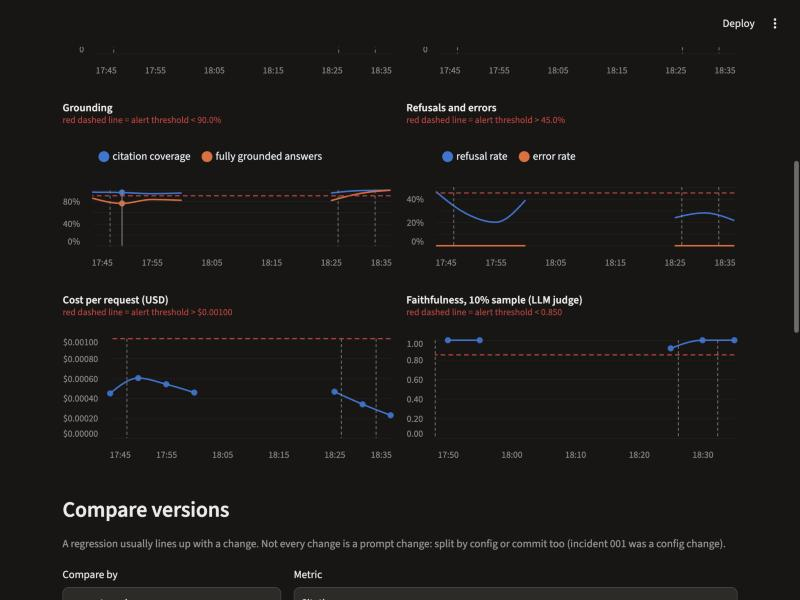
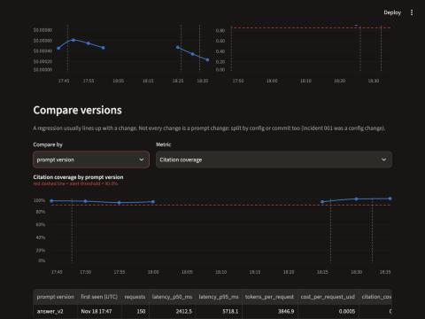
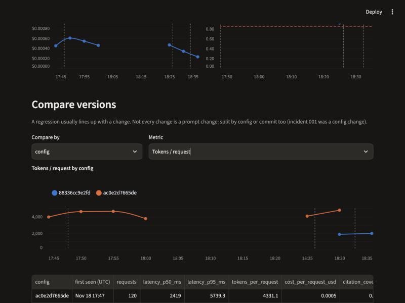
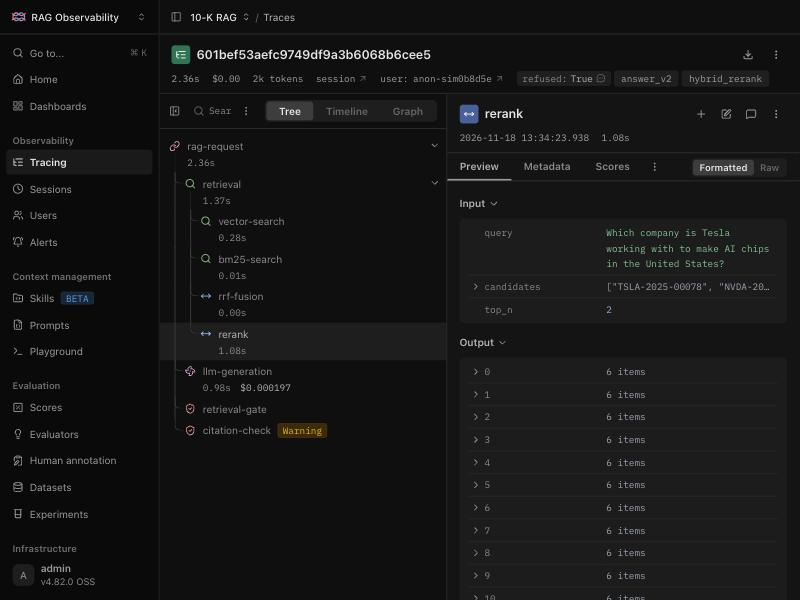

# Incident 001: `top_k 5 → 2` silently cut answer evidence

| | |
|---|---|
| **Date** | 2026-11-18 (planned incident drill; all times UTC) |
| **Severity** | Medium: wrong refusals and incomplete answers, no errors, no outage |
| **Bad change** | commit `6fa88a5`, *"Reduce retrieval top_k 5 -> 2 to cut LLM input tokens"*, config `88336cc9e2fd` |
| **Duration** | 18:31:45 (deployed) → 18:40:54 (rolled back): 9 min |
| **Time to root cause** | **6.7 min** after the monitoring run (8.1 min after the first bad request) |
| **Detected by** | dashboard review. **No alert fired** (see Detection) |

## Summary

A change meant to cut LLM cost reduced the number of chunks sent to the model from
5 to 2. The cost halved as intended, but evidence the model needed was often ranked
3rd–5th by the re-ranker, so it was cut. The model then either refused correctly
answerable questions or gave thinner answers. **Every grounding metric improved
while answers got worse**: citation coverage and faithfulness measure whether what
the model *said* is supported, not whether it said *everything*. No alert fired. The
change was found from the cost/token step change on the dashboard and confirmed by
diffing two traces of the same question, then rolled back.

## Impact (same 30 questions, before vs during)

| Signal | Healthy `0109da3` | Bad `6fa88a5` | |
|---|---|---|---|
| Correct source chunk retrieved (golden questions) | **16 / 17** | **13 / 17** | the real damage |
| Answerable question wrongly refused | 0 | 1 | Tesla / Samsung AI chips |
| Mean answer length (answered in both) | 344 chars | 264 chars | -23% |
| Citations per answer | 1.68 | 1.18 | |
| Refusal rate | 23% | 27% | +1 question |
| Citation coverage | 96.5% | **99.5%** | *looked better* |
| Fully grounded answers | 87% | **95%** | *looked better* |
| Faithfulness (sampled) | 0.92 (n=1) | **1.00** (n=2) | *looked better* |
| p95 latency | 5.6 s | 3.5 s | *looked better* |
| Tokens / request | 4,273 | **1,910** | the visible signature |
| Cost / request | $0.00048 | $0.00023 | |

## Timeline (UTC)

| Time | Event |
|---|---|
| 18:25:34 | Clean baseline deployed: `0109da3` (config `ac0e2d7665de`) |
| 18:25:40–18:31:37 | Healthy traffic: 30 requests (seeded mix, replayed in every period) |
| **18:31:45** | **Bad change deployed**: `6fa88a5`, `retrieval.top_k: 5 → 2` (config `88336cc9e2fd`) |
| 18:32:05–18:37:27 | Traffic on the bad commit: 30 requests, 0 errors, cost halved |
| **18:37:33** | Monitoring job runs: **0 alerts firing** |
| 18:37–18:39 | Dashboard review: cost/request halves at the 18:32 "first seen" marker; per-commit split shows tokens 4,273 → 1,910 and coverage *up* |
| 18:39 | Per-question comparison: gold chunk retrieved 16/17 → 13/17; one new wrong refusal |
| **18:40:12** | **Root cause confirmed** from a trace pair (below) |
| 18:40:54 | **Rolled back**: `cb9c667` reverts `6fa88a5`; config hash back to `ac0e2d7665de` |
| 18:41:02–18:50:48 | Recovery traffic hit an **unrelated network outage** (22/30 errors; see Incident 001b) |
| 18:53:11 | `error_rate_high` FIRES (14.9% > 2%) |
| 18:53:28 | Network restored |
| 18:53:38–19:00:05 | Recovery traffic replayed: 0 errors |
| 19:00:15 | Recovery confirmed: tokens 4,273, gold chunk 16/17, refusals 23%, all matching the healthy period |

## Detection: why no alert fired

1. **Quality alerts look at support, not completeness.** Citation coverage and
   faithfulness ask "is each claim backed by a retrieved chunk?" With 2 chunks the
   model says less, and what it says is still backed. Both metrics went **up**.
2. **The one metric that got worse (refusal rate, +1 of 30) is the noisiest one**,
   so its threshold has a wide margin (45%) by design.
3. **Retrieval quality (hit rate) is only measured offline**, on the golden set
   with known answers. Production traffic has no ground truth.
4. **Cost and token alerts only catch increases.** A 50% *drop* is just as much a
   sign that behaviour changed, and nothing watched for it.

How it was actually found: the cost-per-request chart halves exactly at a dashed
"first seen" marker. A sudden step in tokens per request is never user behaviour;
it's a deploy.

## Investigation

**1. What changed?** Comparing by **prompt version** showed nothing, because the
prompt never changed. This was the first gap the drill found: the dashboard could
only compare prompt versions.

After adding *compare by config / commit* (fix `74aeb8b`, made during the
investigation), the split is obvious: config `88336cc9e2fd` (first seen 18:32) uses
less than half the tokens of `ac0e2d7665de`.

`git show 6fa88a5` → one line: `retrieval.top_k: 5 → 2`.

**2. Did it hurt answers?** The same 30 questions ran in both periods (seeded
traffic), so answers could be compared one to one: the gold source chunk was
retrieved for 13/17 golden questions instead of 16/17; one answerable question was
refused; answers got 23% shorter.

**3. Mechanism, from a trace pair**, *"Which company is Tesla working with to make AI
chips in the United States?"*:

| | healthy trace `63d40957…` | bad trace `601bef53…` |
|---|---|---|
| re-rank #1 | `TSLA-2025-00195` 0.843 kept | `TSLA-2025-00195` 0.843 kept |
| re-rank #2 | `TSLA-2025-00005` 0.540 kept | `TSLA-2025-00005` 0.540 kept |
| re-rank #3 | `TSLA-2025-00009` **0.528 kept** | `TSLA-2025-00009` **0.528 cut** |
| answer | "a new collaboration with **Samsung**… [TSLA-2025-00009]" | "I can't answer that from the documents." |

The re-ranker behaved identically. The evidence was ranked 3rd, only 0.011 below
2nd, and `top_k: 2` cut it before the LLM. The model then *correctly* refused,
because it never saw the evidence. The bug is upstream of the prompt and the
guardrails.

Trace links (local Langfuse):
[healthy](http://localhost:3000/project/rag-10k/traces/63d4095798173f97de8b2a3cd9179c46) ·
[bad](http://localhost:3000/project/rag-10k/traces/601bef53aefc9749df9a3b6068b6cee5)

## Root cause

`configs/config.yaml` → `retrieval.top_k: 2` (commit `6fa88a5`). Re-ranker scores
are tightly packed below the top result (#2 and #3 differ by 0.011 above), so the
cut-off point decides which evidence the model sees. A top-k of 2 regularly dropped
the chunk holding the answer.

## Fix and recovery

Reverted in `cb9c667` (18:40:54). Because `config_hash` is computed from the
config's contents, it returned to the healthy `ac0e2d7665de`: proof the config is
identical, not just "reverted". Replaying the same 30 questions: tokens 4,273
(healthy 4,273), gold chunk 16/17, refusals 23% (23%), Tesla/Samsung answered again.

## Incident 001b (unplanned): network outage during recovery

18:41–18:51, 22 of 30 requests failed with `APIConnectionError` / `APITimeoutError`.
Not Anthropic and not our code: an unrelated site (pypi.org) also timed out from this
machine, while local Langfuse answered normally. `error_rate_high` fired on the next
monitoring run, with the error messages pointing straight at the network.

**Lesson: alert clues show correlation, not cause.** The alert's clue split blamed
the newest commit (`74aeb8b`: 73% errors), but that commit only changed the
dashboard; it was simply the commit running when the network failed. The error
*messages* identified the cause; the commit timing did not. The alert stays FIRING
until the failed requests leave its 60-minute window (~19:51), then resolves.

## What went well

- Every step of every request was in Langfuse: two traces of the same question
  showed the exact cut chunk, with scores, in under a minute.
- `config_hash` / `git_sha` on every trace turned "something changed" into "this
  line in this commit".
- Seeded, replayable traffic made before/after comparisons exact.
- The error-rate alert fired on its first check during the real outage.

## What went wrong

- **No alert fired for a real quality regression.** Our online quality metrics
  measure groundedness, not completeness.
- The dashboard could only compare prompt versions; config changes were invisible
  there until fixed mid-incident.
- New untracked files (these screenshots) marked every trace `+dirty`, which made
  the commit field noisier (fixed in `3705cd9`).

## Action items

| # | Action | Status |
|---|---|---|
| 1 | Dashboard: compare by config and commit; add tokens/request to comparisons | ✅ done, `74aeb8b` |
| 2 | `git_sha`: ignore untracked files when deciding `+dirty` | ✅ done, `3705cd9` |
| 3 | **Phase 3 CI gate:** run the golden-set eval on every PR. This change drops gold-chunk retrieval to 13/17 = 76% on the questions above, below the `hit_rate@5 ≥ 0.80` threshold, so it should be **blocked before deploy**. To verify in Phase 3. | next phase |
| 4 | **Change-detection alert**: notify when tokens/request (or chunks/request) moves more than ±30% against the previous day. A cost *drop* means behaviour changed too. | open |
| 5 | **Online completeness signal**: track citations per answer and answer length, and grade a sampled answer-relevancy metric alongside faithfulness | open |
| 6 | Error alerts: include the top error messages in the alert text, and present commit splits as "correlated with", not as the cause | open |
